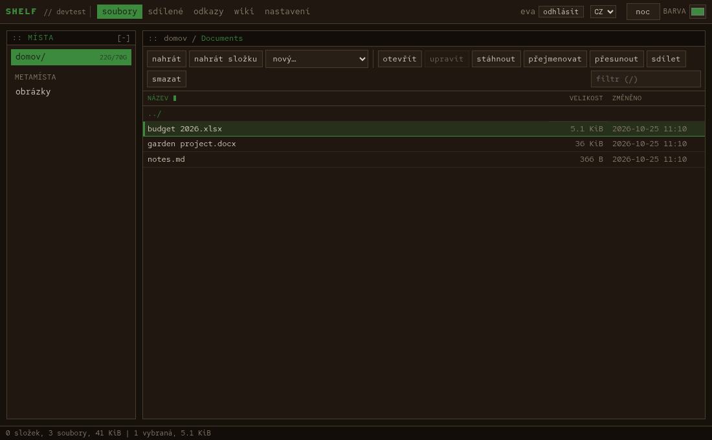
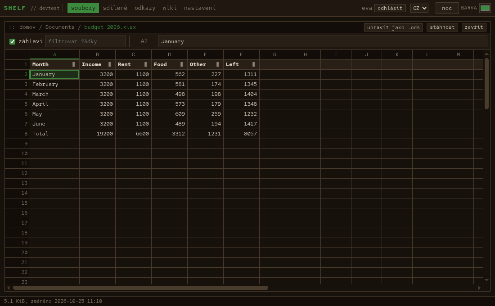
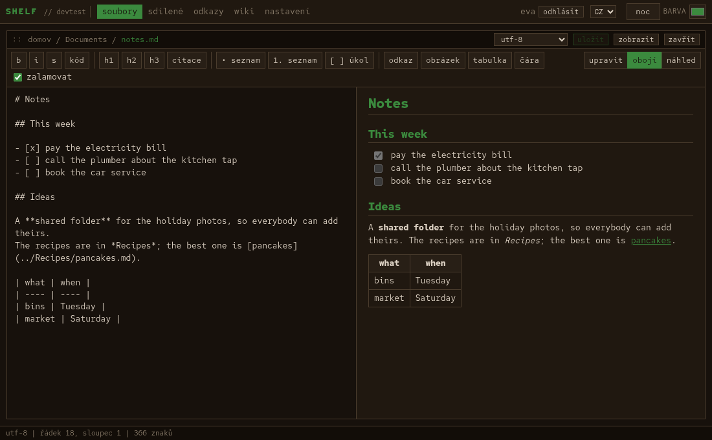
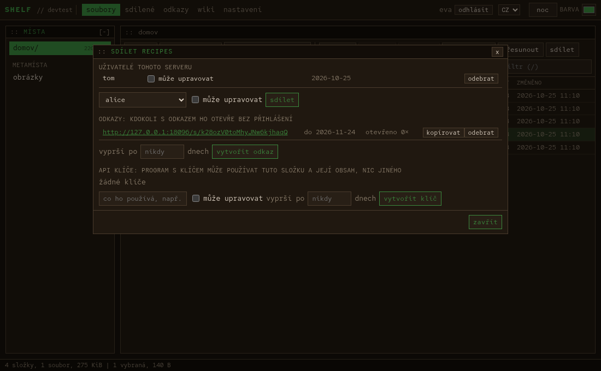
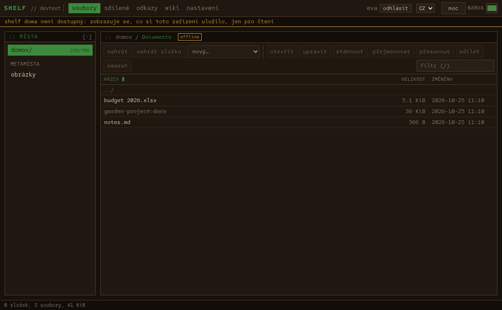
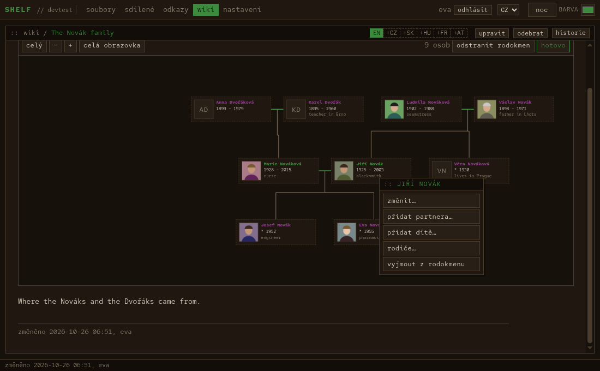

# osada: co to je a jak ho používat

osada je naše úložiště souborů doma: jeden malý server uchovává soubory všech a dostanete se k nim z libovolného prohlížeče i z aplikace pro Android. Většinu druhů souborů umí zobrazit a upravit, sdílet je s ostatními a funguje dál, jen pro čtení, i když server doma není dostupný.

## Přihlášení

- Doma: **http://192.168.1.10**
- Mimo domov: **https://shelf.example.org**, ale jen ze sítí, které admin vašemu účtu povolil (admin → uživatelé → zvenku). Pokud se objeví, že účet odtud použít nelze, řekněte si.
- Účty zakládá admin. Heslo si změníte v **nastavení**.
- Volba jazyka je vpravo nahoře (EN CZ SK HU FR AT). Po přihlášení se zapamatuje pro váš účet a platí i v dalších prohlížečích.

## Úvodní stránka a váš účet

- Po přihlášení se otevře **úvodní stránka**: dlaždice pro vše, co můžete používat (soubory, sdílené, odkazy, wiki, pošta a další programy jako apptab), s vaším úložištěm a účtem.
- Přihlášení chce jméno a heslo, potom druhý krok, pokud ho váš účet má: kód z ověřovací aplikace (TOTP), nebo bezpečnostní klíč či passkey. Některé účty musí používat bezpečnostní klíč.
- **Váš účet** (vaše jméno vpravo nahoře): změna hesla, nastavení ověřovací aplikace a bezpečnostních klíčů a přehled, kde jste přihlášeni; ostatní relace můžete odhlásit.
- **pošta** otevře webmail ve vlastní záložce, pokud máte poštovní schránku.
- Ze kterých sítí mimo domov smí účet osada používat, nastavuje správce u každého účtu (admin → users, outside networks).

## Vaše soubory

**soubory** ukazují váš **domov**: složky a soubory, které vidíte jen vy. Vlevo jsou **místa**: domov, **úložiště** (SFTP servery přidané v nastavení), co vám ostatní dali v **sdíleno se mnou** a metamísto **obrázky**.

- **nahrát** vloží soubory, **nahrát složku** celou složku do složky, ve které jste; soubory můžete i přetáhnout na seznam.
- **nový…** vytvoří složku, poznámku v markdownu, text, tabulku, sešit, dokument nebo prezentaci.
- Vyberte řádek (kliknutím; s shift nebo ctrl jich vyberete víc) a pak **otevřít**, **upravit**, **stáhnout**, **přejmenovat**, **přesunout**, **sdílet**, **verze** nebo **smazat**.
- Klávesnice: šipky posouvají, Enter otevírá, Backspace jde o složku výš, F2 přejmenuje, Del smaže, / filtruje a pár napsaných písmen skočí na jméno.
- Velikosti složek se objeví za chvíli: počítá se všechno uvnitř. Pokud máte limit úložiště, místa ukazují, kolik z něj používáte.

## Prohlížení souborů

Otevřením souboru ho uvidíte: videa a hudbu (s přetáčením), obrázky (i TIFF, Photoshop a raw z fotoaparátů), PDF, text, markdown, tabulky (ods, xlsx, xls, csv), dokumenty (odt, docx, doc, rtf), prezentace (odp, pptx, ppt), poštu (eml, msg), archivy (zip, 7z, rar, tar a další; otevřou se i soubory uvnitř), e-knihy, kalendáře, kontakty a písma. Šipky vlevo a vpravo přejdou na předchozí a další obrázek nebo video ve složce; Esc zavře.

## Úpravy

**upravit** otevře přímo v prohlížeči soubory markdown, text a CSV, sešity (.ods), dokumenty (.odt, .rtf) a prezentace (.odp); ctrl+s ukládá. Markdown má náhled vedle textu (upravit, obojí, náhled).

Soubory Wordu, Excelu a PowerPointu se upravují jako kopie vedle nich: vytvoří ji **upravit jako .ods**, **upravit jako .odt** nebo **upravit jako .odp** a originál zůstane, jak byl. Pokud soubor mezitím uložil někdo jiný, osada se zeptá, než jeho změny přepíše.

## Sdílení

**sdílet** dá složku nebo soubor jiným uživatelům, jen pro čtení, nebo tak, že **může upravovat**; objeví se jim pak v **sdíleno se mnou**. **Veřejný odkaz** funguje pro každého, kdo ho má, i bez účtu, a pokud chcete, jen do určitého data. **odkazy** ukazují vaše odkazy a kolikrát byl který otevřen; odstraněním odkaz hned přestane fungovat.

## Obrázky a starší verze

**obrázky** mezi metamísty ukazují v jedné mřížce všechny vaše obrázky i ty sdílené s vámi, nejnovější první, s prezentací. **verze** ukazují starší verze souboru nebo složky z noční zálohy a vrátí změněné nebo smazané soubory.

## V telefonu

Aplikace pro Android je osada v aplikaci. Nainstalujte ji přes Obtainium z **http://192.168.1.10:88/** (doma); Obtainium ji udržuje aktuální. Na domácí Wi-Fi aplikace používá domácí adresu, jinde veřejnou.

- **nastavení → telefony** spáruje telefon a kopíruje jeho složky (fotoaparát, snímky obrazovky a podobně) do vašeho domova: každou hodinu a brzy po každé nové fotce.
- **Sdílet → osada** v jakékoli aplikaci uloží soubory do domova a vytvoří odkaz, který můžete zkopírovat nebo poslat e-mailem.

## Když osada doma není dostupný

Když server doma není dostupný (výpadek proudu, internetu), osada se přesto otevře z toho, co si váš prohlížeč nebo telefon uložil: složky, které jste prohlíželi, soubory, které jste otevřeli, a tato wiki. Říká to pruh nahoře, nic nejde změnit a co zařízení nikdy neotevřelo, je zašedlé. Veřejné odkazy dál fungují pro soubory, které už veřejný server vydal. Jakmile domov znovu odpoví, pruh zmizí a vše funguje jako dřív.

(V prohlížeči to funguje přes https://shelf.example.org; obyčejná http adresa doma si nic uložit nemůže. Aplikace v telefonu si kopie drží v obou případech.)

## Wiki

Články tady může číst a psát každý.

- **nový článek** založí článek, **upravit** ho změní. Každé uložení zůstává v **historii**, kde se dá starší text prohlédnout a vrátit.
- **připnout** (v článku, nebo v seznamu, když je myš nad řádkem) dá článek nahoru do seznamu, pro všechny; **odepnout** ho vrátí mezi ostatní.
- Článek může mít text v každém jazyce. Záložky nahoře ukazují, které existují; **+SK**, **+HU** a další začnou překlad z textu, který právě čtete. Článek se otevře ve vašem jazyce, pokud ho má, jinak v angličtině.
- Obrázky: **přidat obrázky** v editoru, nebo je přetáhněte či vložte do textu. Zobrazí je `` a patří k článku, ve všech jeho jazycích.
- **Odkazy** na jiné články: v editoru označte pár slov a stiskněte **odkaz** (nebo ctrl+e). Otevře se seznam článků; pište, co hledáte (na diakritice nezáleží), a stiskněte Enter. Funguje i jméno, o kterém zatím nikdo nepsal: takový odkaz má jinou barvu než ostatní a kliknutím na něj můžete ten článek napsat. Odkazy fungují i v souborech markdown.

### Rodokmeny

**přidat rodokmen** vloží do článku rodokmen, pro všechny jeho jazyky. Každá osoba je karta: vlevo obrázek, jméno, data a řádek o ní.

- **upravit rodokmen** a pak klikněte na kartu: **změnit…**, **přidat rodiče…**, **přidat partnera…**, **přidat dítě…**, **rodiče…** nebo **vyjmout z rodokmenu**. Novým příbuzným může být i někdo, kdo už v rodokmenu je.
- Děti s různými partnery: **přidat dítě…** se ptá na druhého rodiče: jednoho z partnerů, **někdo nový…**, někoho dalšího z rodokmenu, nebo zatím nikoho. **rodiče…** nastaví nebo opraví, kdo jsou něčí rodiče, a tak přesune dítě k jinému páru.
- Sourozenci stojí v jedné řadě, podle narození, pokud je rok známý; partner stojí vedle osoby, druhý na druhé straně; zobrazení sleduje, co přidáváte.
- Každé jméno vede na vlastní článek té osoby. Jméno v té druhé barvě článek zatím nemá; kliknutím ho můžete napsat a začne tím, co o osobě říká rodokmen.
- Tažením se posouváte, kolečkem nebo dvěma prsty přibližujete; **celý** ukáže všechno, **celá obrazovka** mu dá celou obrazovku.
- Každá změna se hned uloží a zůstává v **historii**, odkud lze starší rodokmen vrátit.
- **export JSON** uloží rodokmen s články jeho lidí do jednoho souboru: jejich texty, jak jsou napsané, a místo obrázků, kde který je a co podle textů ukazuje.
