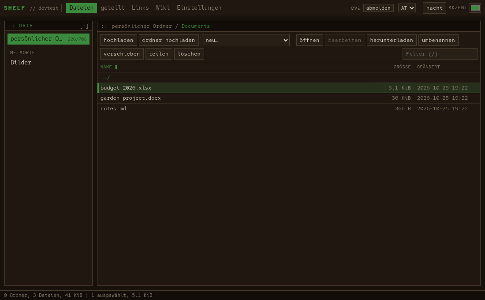
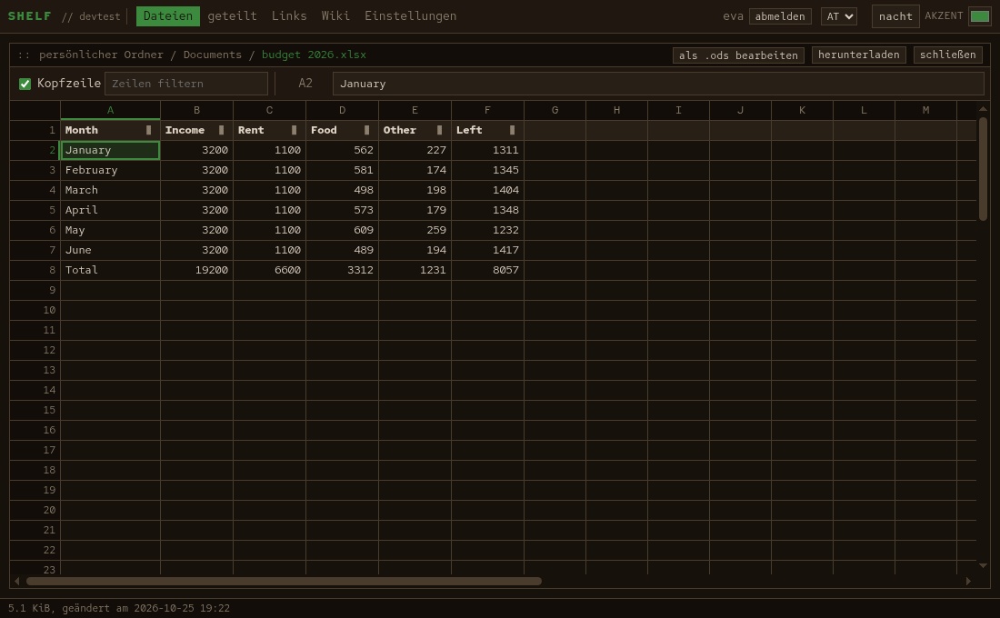
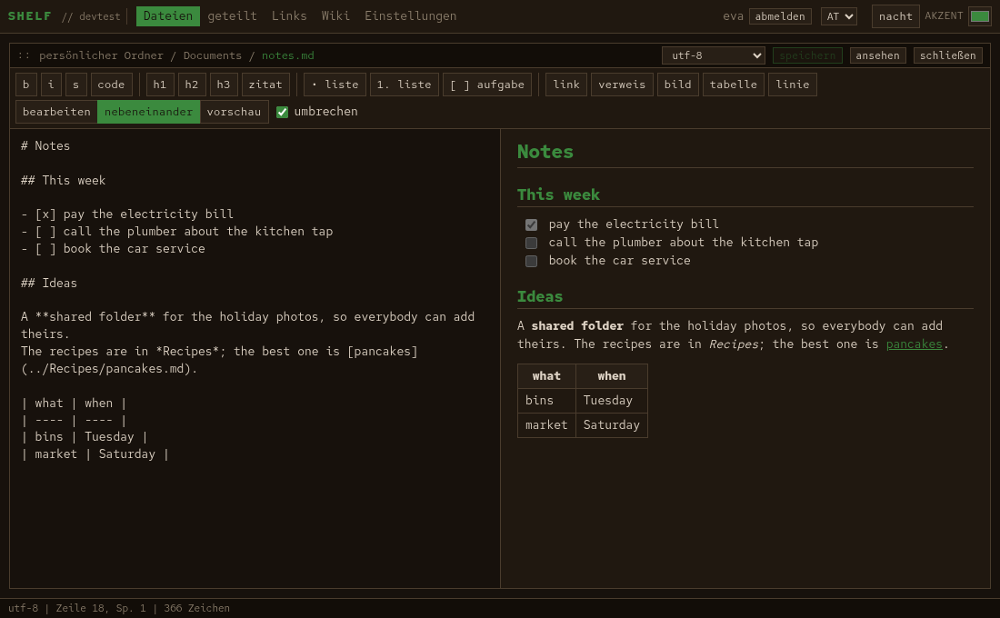
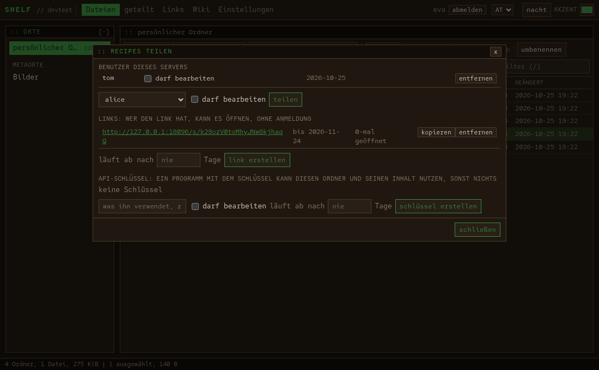
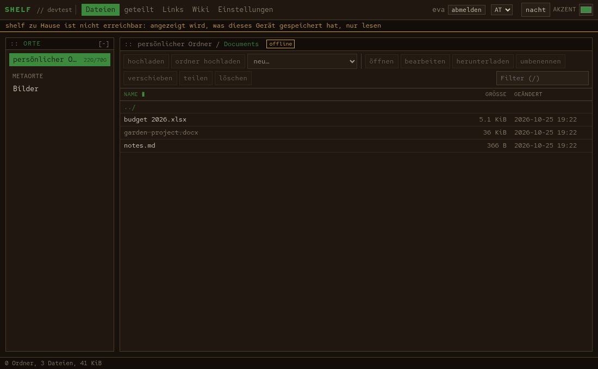
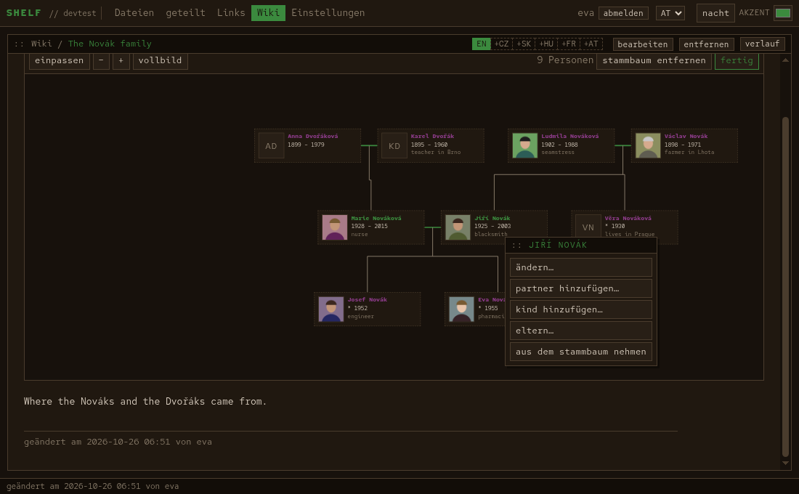

# osada: was es ist und wie man es verwendet

osada ist unser Dateispeicher zu Hause: ein kleiner Server bewahrt die Dateien aller auf, und Sie erreichen sie aus jedem Browser und aus der Android-App. Er zeigt und bearbeitet die meisten Arten von Dateien, teilt sie mit anderen und funktioniert weiter, nur lesend, wenn der Server zu Hause nicht erreichbar ist.

## Anmelden

- Zu Hause: **http://192.168.1.10**
- Unterwegs: **https://shelf.example.org**, aber nur aus den Netzwerken, die der Admin für Ihr Konto freigegeben hat (Admin → Benutzer → von außen). Fragen Sie nach, wenn es heißt, dass Ihr Konto von dort aus nicht verwendet werden kann.
- Die Konten legt der Admin an. Ihr Passwort ändern Sie in den **Einstellungen**.
- Die Sprachauswahl ist rechts oben (EN CZ SK HU FR AT). Sobald Sie angemeldet sind, wird Ihre Wahl für Ihr Konto gespeichert und gilt auch in anderen Browsern.

## Die Startseite und Ihr Konto

- Nach der Anmeldung öffnet sich die **Startseite**: eine Kachel für alles, was Sie nutzen können (Dateien, geteilt, Links, Wiki, Mail und andere Programme wie apptab), mit Ihrem Speicher und Ihrem Konto.
- Die Anmeldung fragt nach Name und Passwort, dann nach einem zweiten Schritt, wenn Ihr Konto einen hat: einem Code aus einer Authenticator-App (TOTP) oder einem Sicherheitsschlüssel bzw. Passkey. Manche Konten müssen einen Sicherheitsschlüssel verwenden.
- **Ihr Konto** (Ihr Name oben rechts): Passwort ändern, Authenticator-App und Sicherheitsschlüssel einrichten und sehen, wo Sie angemeldet sind; die anderen Sitzungen können Sie abmelden.
- **Mail** öffnet das Webmail in einem eigenen Tab, wenn Sie ein Postfach haben.
- Aus welchen Netzen außerhalb des Hauses ein Konto osada nutzen darf, legt der Admin pro Konto fest (admin → users, outside networks).

## Ihre Dateien

**Dateien** zeigt Ihren **persönlichen Ordner**: die Ordner und Dateien, die nur Sie sehen. Links sind die **Orte**: Ihr persönlicher Ordner, **Speicher** (SFTP-Server, die Sie in den Einstellungen hinzugefügt haben), was andere unter **mit mir geteilt** für Sie freigegeben haben, und der Metaort **Bilder**.

- **hochladen** legt Dateien, **Ordner hochladen** einen ganzen Ordner in den Ordner, in dem Sie gerade sind; Sie können sie auch auf die Liste ziehen.
- **neu…** erstellt einen Ordner, eine Markdown-Notiz, einen Text, eine Tabelle, ein Tabellendokument, ein Dokument oder eine Präsentation.
- Wählen Sie eine Zeile aus (Klick; mit Umschalt oder Strg und Klick mehrere), dann **öffnen**, **bearbeiten**, **herunterladen**, **umbenennen**, **verschieben**, **teilen**, **Versionen** oder **löschen**.
- Tastatur: die Pfeiltasten bewegen, die Eingabetaste öffnet, die Rücktaste geht einen Ordner hinauf, F2 benennt um, Entf löscht, / filtert, und ein paar getippte Buchstaben springen zu einem Namen.
- Ordnergrößen erscheinen nach einem Moment: alles darin zählt. Mit einem Speicherlimit zeigen die Orte, wie viel davon Sie verwenden.

## Dateien ansehen

Öffnen Sie eine Datei, um sie zu sehen: Videos und Musik (mit Spulen), Bilder (auch TIFF, Photoshop und RAW von Kameras), PDF, Text, Markdown, Tabellen (ods, xlsx, xls, csv), Dokumente (odt, docx, doc, rtf), Präsentationen (odp, pptx, ppt), E-Mails (eml, msg), Archive (zip, 7z, rar, tar und mehr; auch die Dateien darin lassen sich öffnen), E-Books, Kalender, Kontakte und Schriften. Die Pfeiltasten links und rechts gehen zum vorigen und nächsten Bild oder Video im Ordner; Esc schließt.

## Bearbeiten

**bearbeiten** öffnet Markdown-, Text- und CSV-Dateien, Tabellendokumente (.ods), Dokumente (.odt, .rtf) und Präsentationen (.odp) direkt im Browser; Strg+S speichert. Markdown hat eine Vorschau neben dem Text (bearbeiten, nebeneinander, Vorschau).

Word-, Excel- und PowerPoint-Dateien werden als Kopie daneben bearbeitet: **als .ods bearbeiten**, **als .odt bearbeiten** oder **als .odp bearbeiten** erstellt sie, und das Original bleibt, wie es war. Hat jemand anderer die Datei gespeichert, während Sie sie bearbeitet haben, fragt osada, bevor es dessen Änderungen überschreibt.

## Teilen

**teilen** gibt einen Ordner oder eine Datei an andere Benutzer weiter, nur lesend oder mit **darf bearbeiten**; danach erscheint es bei ihnen unter **mit mir geteilt**. Ein **öffentlicher Link** funktioniert für jeden, der ihn hat, ohne Konto, auf Wunsch nur bis zu einem Datum. **Links** zeigt Ihre Links und wie oft jeder geöffnet wurde; wer einen Link entfernt, stoppt ihn sofort.

## Bilder und frühere Versionen

**Bilder** bei den Metaorten zeigt alle Ihre Bilder und alle mit Ihnen geteilten in einem Raster, die neuesten zuerst, mit einer Diashow. **Versionen** zeigt frühere Versionen einer Datei oder eines Ordners aus der nächtlichen Sicherung und stellt geänderte oder gelöschte Dateien wieder her.

## Am Telefon

Die Android-App ist osada in einer App. Installieren Sie sie mit Obtainium von **http://192.168.1.10:88/** (zu Hause); Obtainium hält sie aktuell. Die App verwendet im WLAN zu Hause die Adresse zu Hause und überall sonst die öffentliche.

- **Einstellungen → Telefone** koppelt das Telefon und kopiert seine Ordner (Kamera, Bildschirmfotos und so weiter) in Ihren persönlichen Ordner: jede Stunde und bald nach jedem neuen Foto.
- **Teilen → osada** in einer beliebigen App legt Dateien in Ihren persönlichen Ordner und erstellt einen Link, den Sie kopieren oder per E-Mail schicken können.

## Wenn osada zu Hause nicht erreichbar ist

Ist der Server zu Hause nicht erreichbar (Stromausfall, Internetausfall), öffnet sich osada trotzdem aus dem, was Ihr Browser oder Ihr Telefon gespeichert hat: die Ordner, die Sie angesehen haben, die Dateien, die Sie geöffnet haben, und dieses Wiki. Ein Balken oben sagt es, nichts lässt sich ändern, und was das Gerät nie geöffnet hat, ist ausgegraut. Öffentliche Links funktionieren weiter für Dateien, die der öffentliche Server schon ausgeliefert hat. Sobald der Server zu Hause wieder antwortet, verschwindet der Balken, und alles funktioniert wie vorher.

(Im Browser funktioniert das über https://shelf.example.org; die einfache http-Adresse zu Hause kann nichts speichern. Die App am Telefon behält ihre Kopien in beiden Fällen.)

## Das Wiki

Hier können alle Artikel lesen und schreiben.

- **neuer Artikel** beginnt einen; **bearbeiten** ändert ihn. Jedes Speichern bleibt im **Verlauf**, wo ein älterer Text angesehen und wiederhergestellt werden kann.
- **anheften** (im Artikel, oder in der Liste, wenn die Maus über einer Zeile ist) stellt einen Artikel an den Anfang der Liste, für alle; **lösen** reiht ihn wieder bei den anderen ein.
- Ein Artikel kann in jeder Sprache einen Text haben. Die Reiter oben zeigen, welche es gibt; **+CZ**, **+AT** und so weiter beginnen eine Übersetzung aus dem Text, den Sie gerade lesen. Ein Artikel öffnet sich in Ihrer Sprache, wenn er sie hat, sonst auf Englisch.
- Bilder: **Bilder hinzufügen** im Editor, oder ziehen Sie sie in den Text oder fügen Sie sie ein. Sie erscheinen mit `` und gehören zum Artikel, in all seinen Sprachen.
- **Verweise** auf andere Artikel: markieren Sie im Editor ein paar Wörter und drücken Sie **Verweis** (oder Strg+E). Eine Liste der Artikel öffnet sich; tippen Sie zum Suchen (Akzente und Umlaute spielen keine Rolle) und drücken Sie die Eingabetaste. Auch ein Name, über den noch niemand geschrieben hat, geht: so ein Verweis hat eine andere Farbe als die übrigen, und ein Klick darauf bietet an, diesen Artikel zu schreiben. Verweise funktionieren auch in Markdown-Dateien.

### Stammbäume

**Stammbaum hinzufügen** fügt einem Artikel einen Stammbaum hinzu, für alle seine Sprachen. Jede Person ist eine Karte: links ein Bild, der Name, die Daten und eine Zeile über die Person.

- **Stammbaum bearbeiten**, dann eine Karte anklicken: **ändern…**, **Elternteil hinzufügen…**, **Partner hinzufügen…**, **Kind hinzufügen…**, **Eltern…** oder **aus dem Stammbaum nehmen**. Ein neuer Verwandter kann auch jemand sein, der schon im Stammbaum ist.
- Kinder mit verschiedenen Partnern: **Kind hinzufügen…** fragt nach dem anderen Elternteil: einer der Partner, **jemand Neuer…**, jemand anderer aus dem Stammbaum oder noch niemand. **Eltern…** legt fest oder korrigiert, wer die Eltern einer Person sind, und verschiebt so ein Kind zu einem anderen Paar.
- Geschwister stehen in einer Reihe, nach ihrer Geburt, wenn das Jahr bekannt ist; ein Partner kommt neben die Person, ein zweiter auf die andere Seite; die Ansicht folgt dem, was Sie hinzufügen.
- Jeder Name führt zum eigenen Artikel der Person. Ein Name in der anderen Farbe hat noch keinen Artikel; ein Klick bietet an, ihn zu schreiben, beginnend mit dem, was der Stammbaum über die Person sagt.
- Ziehen verschiebt die Ansicht, das Mausrad oder zwei Finger zoomen; **einpassen** zeigt alles, **Vollbild** gibt ihm den ganzen Bildschirm.
- Jede Änderung wird sofort gespeichert und bleibt im **Verlauf**, aus dem ein früherer Stammbaum wiederhergestellt werden kann.
- **JSON exportieren** speichert den Stammbaum mit den Artikeln seiner Personen in einer Datei: ihre Texte, wie sie geschrieben sind, und statt der Bilder, wo jedes ist und was es laut den Texten zeigt.
