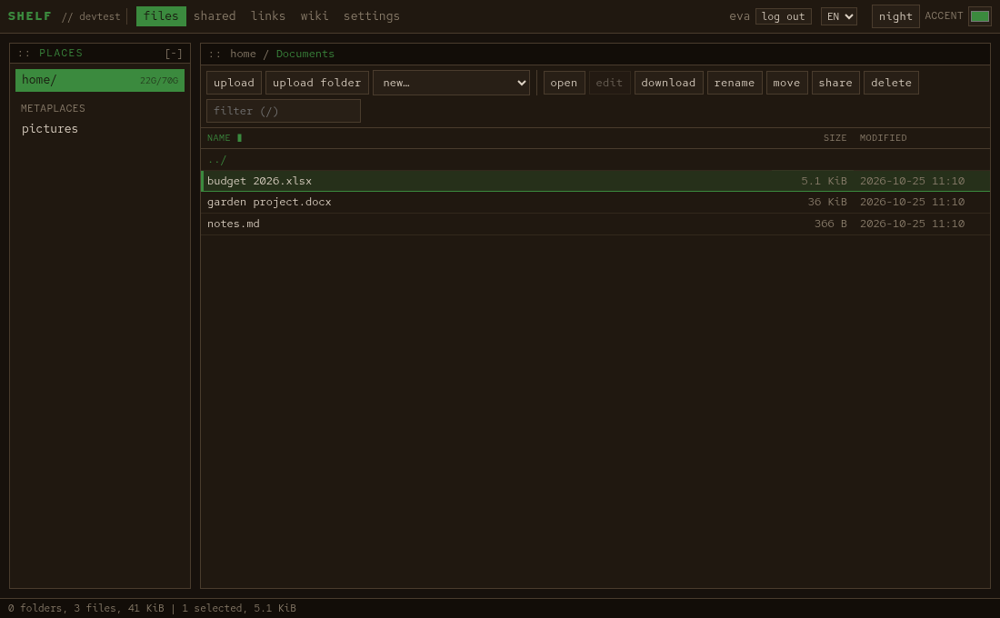
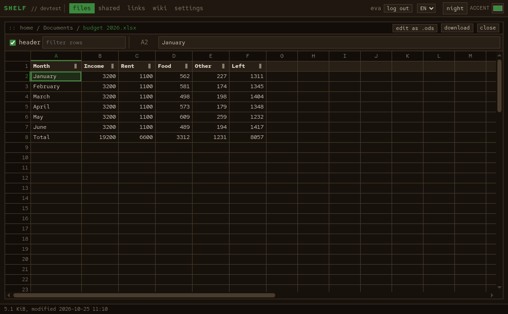
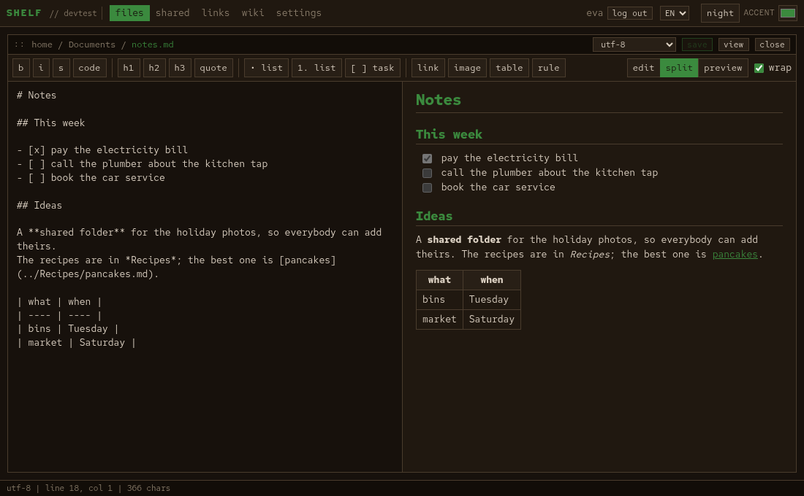
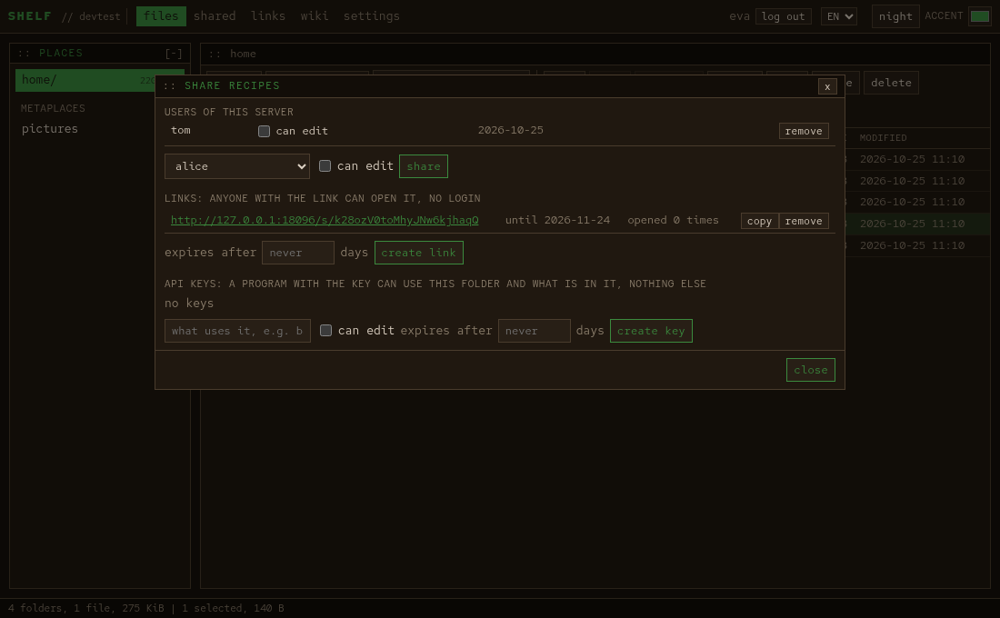
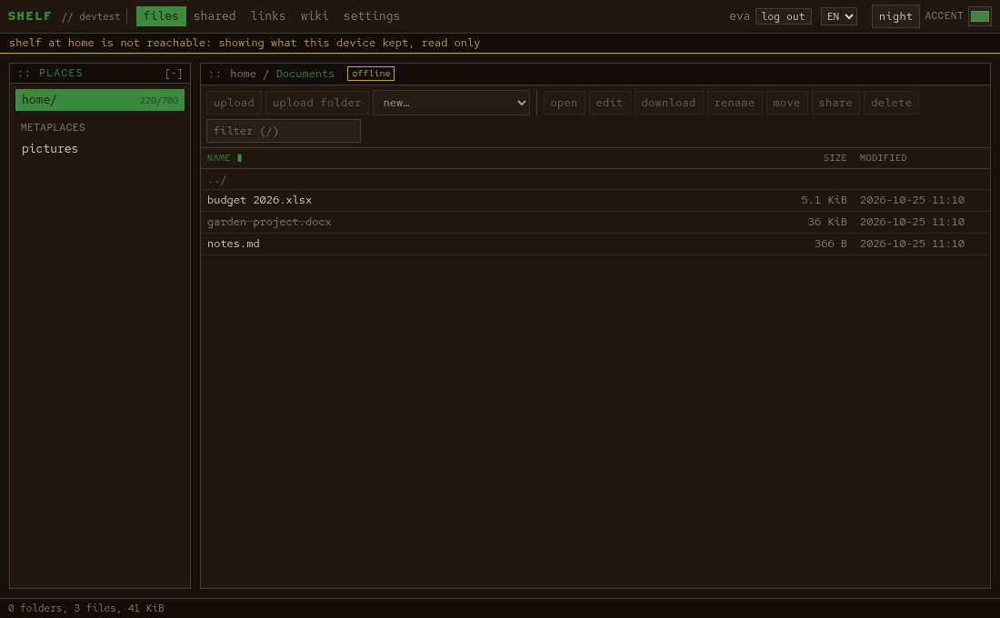
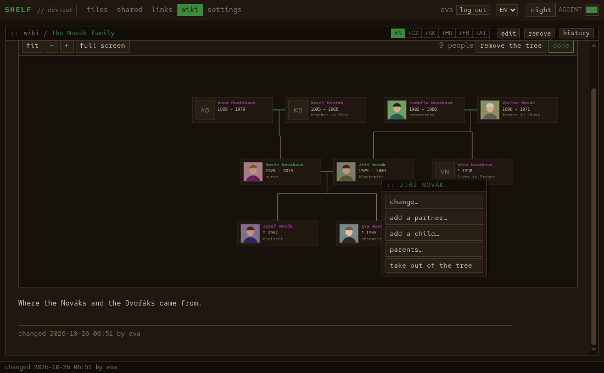

# osada: what it is and how to use it

osada is our file storage at home: one small server keeps everybody's files, and you reach them from any browser and from the Android app. It shows and edits most kinds of files, shares them with others, and keeps working, read only, when the server at home is away.

## Getting in

- At home: **http://192.168.1.10**
- Away from home: **https://shelf.example.org**, but only from the networks the admin allowed for your account (admin → users → outside). Ask if it says your account cannot be used from where you are.
- The admin makes the accounts. Change your password in **settings**.
- The language picker is at the top right (EN CZ SK HU FR AT). Once you are logged in, your pick is kept for your account and follows you to other browsers.

## The start page and your account

- After signing in you land on the **start page**: a tile for each thing you can use (files, shared, links, wiki, mail, and other programs such as apptab), with your storage and your account.
- Signing in asks for your name and password, then for a second step if your account has one: a code from an authenticator app (TOTP), or a security key or passkey. Some accounts must use a security key.
- **Your account** (your name at the top right): change your password, set up the authenticator app and security keys, and see where you are signed in; you can sign out the other sessions.
- **mail** opens the webmail in a tab of its own, if you have a mailbox.
- From which networks outside home an account may use osada is set by the admin, per account (admin → users, outside networks).

## Your files

**files** shows your **home**: the folders and files only you see. On the left are the **places**: your home, **storage** (SFTP servers you added in settings), what others have **shared with me**, and the **pictures** metaplace.

- **upload** puts files, **upload folder** a whole folder, into the folder you are in; you can also drop them onto the list.
- **new…** makes a folder, a markdown note, a text, a table, a spreadsheet, a document or a presentation.
- Select a row (click; shift or ctrl and click for several), then **open**, **edit**, **download**, **rename**, **move**, **share**, **versions** or **delete**.
- Keyboard: arrows move, Enter opens, Backspace goes up a folder, F2 renames, Del deletes, / filters, and typing a few letters jumps to a name.
- Folder sizes appear after a moment: everything inside counts. With a storage limit, the places show how much of it you use.

## Looking at files

Open a file to see it: videos and music (with seeking), pictures (also TIFF, Photoshop and camera raw), PDF, text, markdown, spreadsheets (ods, xlsx, xls, csv), documents (odt, docx, doc, rtf), presentations (odp, pptx, ppt), mail (eml, msg), archives (zip, 7z, rar, tar and more; the files inside open too), e-books, calendars, contacts and fonts. The left and right arrows go to the previous and next picture or video in the folder; Esc closes.

## Editing

**edit** opens markdown, text and CSV files, spreadsheets (.ods), documents (.odt, .rtf) and presentations (.odp) right in the browser; ctrl+s saves. Markdown has a preview next to the text (edit, split, preview).

Word, Excel and PowerPoint files are edited as a copy next to them: **edit as .ods**, **edit as .odt** or **edit as .odp** makes it, and the original stays as it was. If somebody else saved the file while you were editing, osada asks before it overwrites their changes.

## Sharing

**share** gives a folder or a file to other users, read only or so that they **can edit**; it then shows up in their **shared with me**. A **public link** works for anybody who has it, without an account, if you like only until a date. **links** lists your links and how often each was opened; removing a link stops it at once.

## Pictures and earlier versions

**pictures**, under the metaplaces, shows every picture you have and every picture shared with you in one grid, newest first, with a slideshow. **versions** shows earlier versions of a file or a folder from the nightly backup, and puts back changed or deleted files.

## On the phone

The Android app is osada in an app. Install it with Obtainium from **http://192.168.1.10:88/** (at home); Obtainium keeps it up to date. The app uses the home address on the home Wi-Fi and the public one everywhere else.

- **settings → phones** pairs the phone and copies its folders (camera, screenshots and so on) into your home: every hour, and soon after a new picture.
- **share → osada** in any app puts files into your home and makes a link you can copy or mail.

## When osada at home is away

When the server at home cannot be reached (power, the internet line), osada still opens from what your browser or phone kept: the folders you looked at, the files you opened, and this wiki. A bar at the top says so, nothing can be changed, and what the device never opened is greyed out. Public links keep working for files the public server already handed out. When home answers again, the bar goes and everything works as before.

(In a browser this works through https://shelf.example.org; the plain http address at home cannot keep anything. The phone app keeps its copies either way.)

## The wiki

Everybody can read and write articles here.

- **new article** starts one; **edit** changes it. Every save is kept in the **history**, where an older text can be looked at and put back.
- **pin** (in the article, or in the list when the mouse is over a row) puts an article at the top of the list, for everybody; **unpin** takes it back among the others.
- An article can have a text in each language. The tabs at the top show which ones exist; **+CZ**, **+SK** and so on start a translation from the text you are reading. An article opens in your language when it has it, otherwise in English.
- Pictures: **add pictures** in the editor, or drop or paste them into the text. They show with `` and belong to the article, in all its languages.
- **References** to other articles: select a few words in the editor and press **reference** (or ctrl+e). A list of the articles opens; type to search (accents do not matter) and press Enter. A name nobody has written about yet works too: such a reference shows in another colour than the rest, and a click on it offers to write that article. References work in markdown files too.

### Family trees

**add a family tree** puts a family tree into an article, for all its languages. Every person is a card: a picture on the left, the name, the dates and a line about them.

- **edit the tree**, then click a card: **change…**, **add a parent…**, **add a partner…**, **add a child…**, **parents…** or **take out of the tree**. A new relative can also be somebody already in the tree.
- Children with different partners: **add a child…** asks for the other parent: one of the partners, **somebody new…**, somebody else in the tree, or nobody yet. **parents…** sets or corrects who someone's parents are, and so moves a child to another couple.
- Brothers and sisters stand in one row, in order of birth where the year is known; a partner goes beside the person, a second one on the other side; the view follows what you add.
- Every name leads to that person's own article. A name in the other colour has no article yet; a click offers to write it, starting with what the tree says about them.
- Drag to move around, use the wheel or two fingers to zoom; **fit** shows all of it, **full screen** gives it the whole screen.
- Every change is saved at once and kept in the **history**, where an earlier tree can be put back.
- **export JSON** saves the tree with the articles of its people as one file: their texts as written and, instead of the pictures, where each one is and what the texts say it shows.
