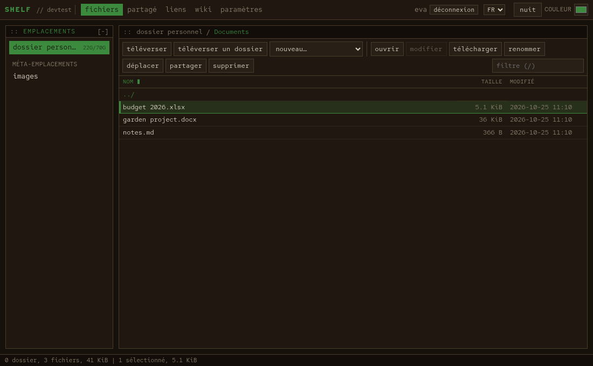
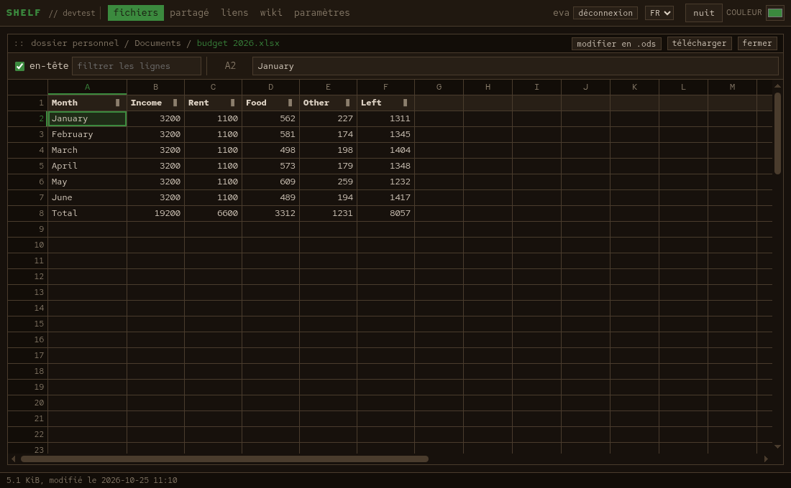
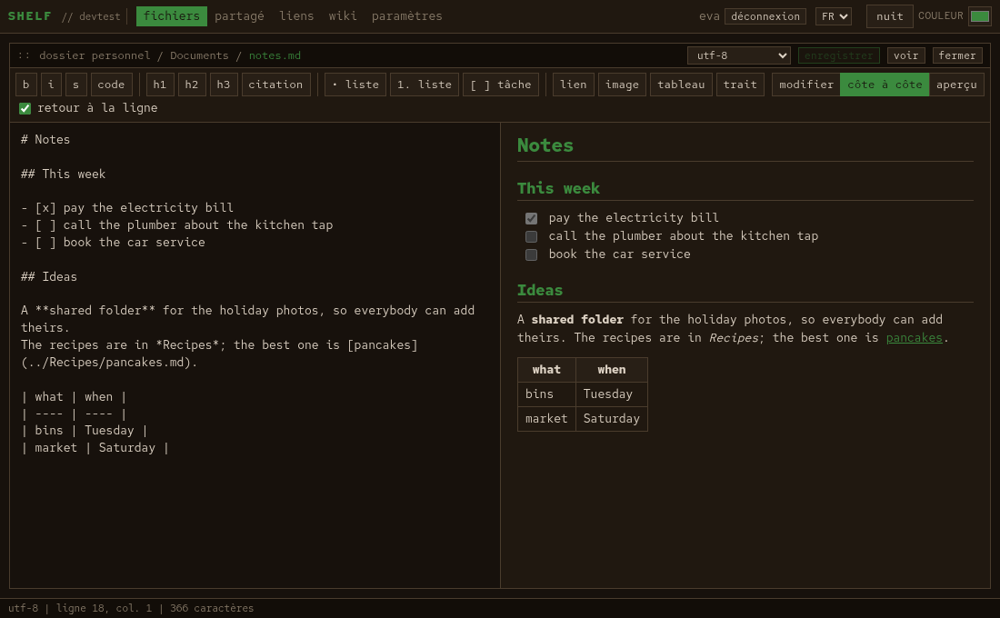
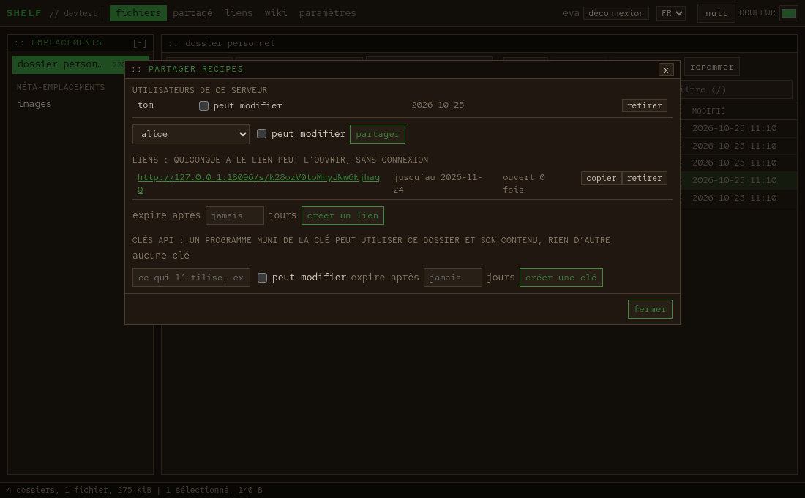
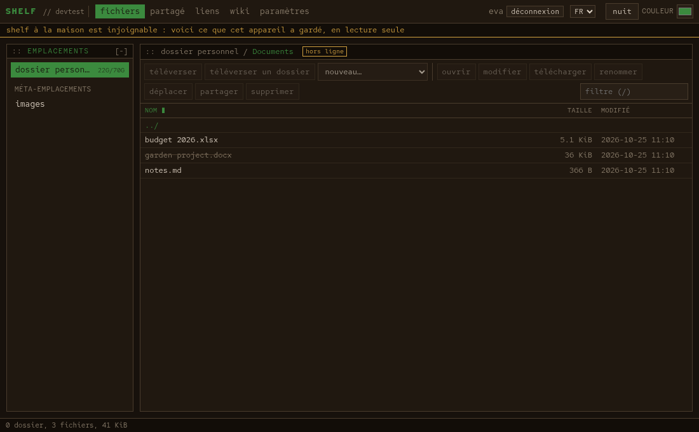
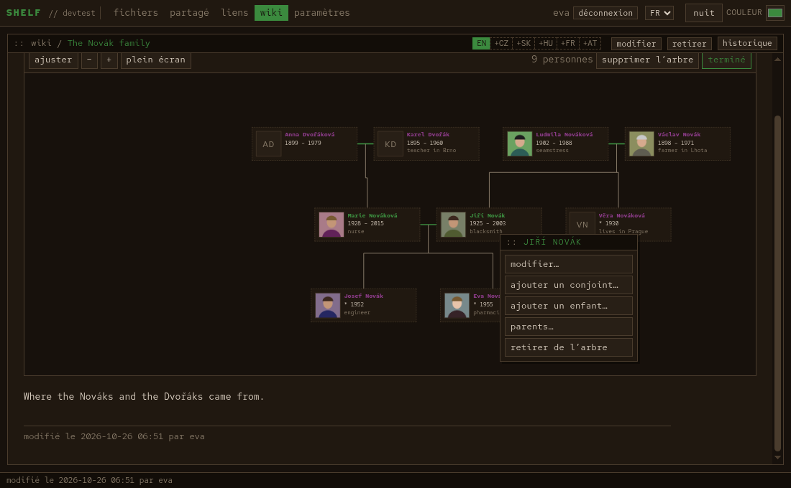

# osada : ce que c’est et comment s’en servir

osada est notre stockage de fichiers à la maison : un petit serveur garde les fichiers de tout le monde, accessibles depuis n’importe quel navigateur et depuis l’application Android. Il affiche et modifie la plupart des types de fichiers, les partage avec d’autres, et continue de fonctionner, en lecture seule, quand le serveur de la maison est injoignable.

## Se connecter

- À la maison : **http://192.168.1.10**
- Hors de la maison : **https://shelf.example.org**, mais seulement depuis les réseaux que l’admin a autorisés pour votre compte (admin → utilisateurs → extérieur). S’il indique que votre compte ne peut pas être utilisé depuis là où vous êtes, demandez.
- C’est l’admin qui crée les comptes. Changez votre mot de passe dans les **paramètres**.
- Le choix de la langue est en haut à droite (EN CZ SK HU FR AT). Une fois connecté, il est gardé pour votre compte et vous suit dans les autres navigateurs.

## La page d'accueil et votre compte

- Après la connexion, vous arrivez sur la **page d'accueil** : une tuile pour chaque chose que vous pouvez utiliser (fichiers, partagés, liens, wiki, courrier et d'autres programmes comme apptab), avec votre stockage et votre compte.
- La connexion demande votre nom et votre mot de passe, puis une seconde étape si votre compte en a une : un code d'une application d'authentification (TOTP), ou une clé de sécurité ou une passkey. Certains comptes doivent utiliser une clé de sécurité.
- **Votre compte** (votre nom en haut à droite) : changer le mot de passe, configurer l'application d'authentification et les clés de sécurité, et voir où vous êtes connecté ; vous pouvez déconnecter les autres sessions.
- **courrier** ouvre le webmail dans un onglet à part, si vous avez une boîte aux lettres.
- Les réseaux hors de la maison depuis lesquels un compte peut utiliser osada sont réglés par l'admin, compte par compte (admin → users, outside networks).

## Vos fichiers

**fichiers** montre votre **dossier personnel** : les dossiers et fichiers que vous seul voyez. À gauche se trouvent les **emplacements** : votre dossier personnel, le **stockage** (les serveurs SFTP ajoutés dans les paramètres), ce que d’autres ont mis dans **partagé avec moi**, et le méta-emplacement **images**.

- **téléverser** envoie des fichiers, **téléverser un dossier** tout un dossier, dans le dossier où vous êtes ; vous pouvez aussi les déposer sur la liste.
- **nouveau…** crée un dossier, une note markdown, un texte, un tableau, un classeur, un document ou une présentation.
- Sélectionnez une ligne (un clic ; maj ou ctrl et clic pour plusieurs), puis **ouvrir**, **modifier**, **télécharger**, **renommer**, **déplacer**, **partager**, **versions** ou **supprimer**.
- Clavier : les flèches se déplacent, Entrée ouvre, Retour arrière remonte d’un dossier, F2 renomme, Suppr supprime, / filtre, et taper quelques lettres saute à un nom.
- La taille des dossiers apparaît après un instant : tout ce qu’ils contiennent compte. Avec une limite de stockage, les emplacements montrent combien vous en utilisez.

## Regarder des fichiers

Ouvrez un fichier pour le voir : vidéos et musique (avec avance et retour), images (aussi TIFF, Photoshop et raw d’appareils photo), PDF, texte, markdown, classeurs (ods, xlsx, xls, csv), documents (odt, docx, doc, rtf), présentations (odp, pptx, ppt), courriels (eml, msg), archives (zip, 7z, rar, tar et d’autres ; les fichiers qu’elles contiennent s’ouvrent aussi), livres numériques, agendas, contacts et polices. Les flèches gauche et droite passent à l’image ou la vidéo précédente et suivante du dossier ; Échap ferme.

## Modifier

**modifier** ouvre directement dans le navigateur les fichiers markdown, texte et CSV, les classeurs (.ods), les documents (.odt, .rtf) et les présentations (.odp) ; ctrl+s enregistre. Le markdown a un aperçu à côté du texte (modifier, côte à côte, aperçu).

Les fichiers Word, Excel et PowerPoint se modifient sous forme de copie à côté d’eux : **modifier en .ods**, **modifier en .odt** ou **modifier en .odp** la crée, et l’original reste tel qu’il était. Si quelqu’un d’autre a enregistré le fichier pendant que vous le modifiiez, osada demande avant d’écraser ses changements.

## Partager

**partager** donne un dossier ou un fichier à d’autres utilisateurs, en lecture seule ou avec **peut modifier** ; il apparaît alors dans leur **partagé avec moi**. Un **lien public** fonctionne pour toute personne qui l’a, sans compte, et si vous voulez seulement jusqu’à une date. **liens** liste vos liens et combien de fois chacun a été ouvert ; supprimer un lien l’arrête aussitôt.

## Images et versions antérieures

**images**, parmi les méta-emplacements, montre dans une seule grille toutes vos images et celles partagées avec vous, les plus récentes d’abord, avec un diaporama. **versions** montre les versions antérieures d’un fichier ou d’un dossier tirées de la sauvegarde de la nuit, et remet en place les fichiers modifiés ou supprimés.

## Sur le téléphone

L’application Android, c’est osada dans une application. Installez-la avec Obtainium depuis **http://192.168.1.10:88/** (à la maison) ; Obtainium la tient à jour. Sur le Wi-Fi de la maison, l’application utilise l’adresse de la maison, ailleurs l’adresse publique.

- **paramètres → téléphones** associe le téléphone et copie ses dossiers (appareil photo, captures d’écran, etc.) dans votre dossier personnel : toutes les heures, et peu après chaque nouvelle photo.
- **Partager → osada**, dans n’importe quelle application, met les fichiers dans votre dossier personnel et crée un lien à copier ou à envoyer par courriel.

## Quand osada à la maison est injoignable

Quand le serveur de la maison est injoignable (coupure de courant, d’internet), osada s’ouvre quand même à partir de ce que votre navigateur ou votre téléphone a gardé : les dossiers que vous avez regardés, les fichiers que vous avez ouverts, et ce wiki. Une barre en haut le signale, rien ne peut être modifié, et ce que l’appareil n’a jamais ouvert est grisé. Les liens publics continuent de marcher pour les fichiers que le serveur public a déjà servis. Dès que la maison répond de nouveau, la barre disparaît et tout fonctionne comme avant.

(Dans un navigateur, cela fonctionne par https://shelf.example.org ; l’adresse http simple de la maison ne peut rien garder. L’application du téléphone garde ses copies dans les deux cas.)

## Le wiki

Tout le monde peut lire et écrire des articles ici.

- **nouvel article** en commence un ; **modifier** le change. Chaque enregistrement est gardé dans l’**historique**, où un texte plus ancien peut être consulté et rétabli.
- **épingler** (dans l’article, ou dans la liste quand la souris survole une ligne) met un article en haut de la liste, pour tout le monde ; **désépingler** le remet parmi les autres.
- Un article peut avoir un texte dans chaque langue. Les onglets en haut montrent lesquels existent ; **+CZ**, **+SK** et les autres commencent une traduction à partir du texte que vous lisez. Un article s’ouvre dans votre langue s’il l’a, sinon en anglais.
- Images : **ajouter des images** dans l’éditeur, ou déposez-les ou collez-les dans le texte. `` les affiche ; elles appartiennent à l’article, dans toutes ses langues.
- Des **renvois** vers d’autres articles : sélectionnez quelques mots dans l’éditeur et appuyez sur **renvoi** (ou ctrl+e). La liste des articles s’ouvre ; tapez pour chercher (les accents ne comptent pas) et appuyez sur Entrée. Un nom dont personne n’a encore parlé marche aussi : un tel renvoi a une autre couleur que les autres, et un clic dessus propose d’écrire l’article. Les renvois marchent aussi dans les fichiers markdown.

### Arbres généalogiques

**ajouter un arbre généalogique** met un arbre dans un article, pour toutes ses langues. Chaque personne est une carte : une image à gauche, le nom, les dates et une ligne à son sujet.

- **modifier l’arbre**, puis cliquez sur une carte : **modifier…**, **ajouter un parent…**, **ajouter un conjoint…**, **ajouter un enfant…**, **parents…** ou **retirer de l’arbre**. Un nouveau parent peut aussi être quelqu’un qui est déjà dans l’arbre.
- Des enfants avec des conjoints différents : **ajouter un enfant…** demande l’autre parent : l’un des conjoints, **quelqu’un de nouveau…**, quelqu’un d’autre de l’arbre, ou personne pour l’instant. **parents…** fixe ou corrige qui sont les parents de quelqu’un, et déplace ainsi un enfant vers un autre couple.
- Les frères et sœurs sont sur une même rangée, par ordre de naissance quand l’année est connue ; un conjoint se place à côté de la personne, un deuxième de l’autre côté ; la vue suit ce que vous ajoutez.
- Chaque nom mène à l’article de la personne. Un nom de l’autre couleur n’a pas encore d’article ; un clic propose de l’écrire, en commençant par ce que l’arbre dit d’elle.
- Faites glisser pour vous déplacer, la molette ou deux doigts pour zoomer ; **ajuster** montre tout, **plein écran** lui donne tout l’écran.
- Chaque changement est enregistré aussitôt et gardé dans l’**historique**, d’où un arbre antérieur peut être rétabli.
- **exporter en JSON** enregistre l’arbre avec les articles de ses personnes dans un seul fichier : leurs textes tels qu’écrits et, au lieu des images, où se trouve chacune et ce que les textes disent qu’elle montre.
