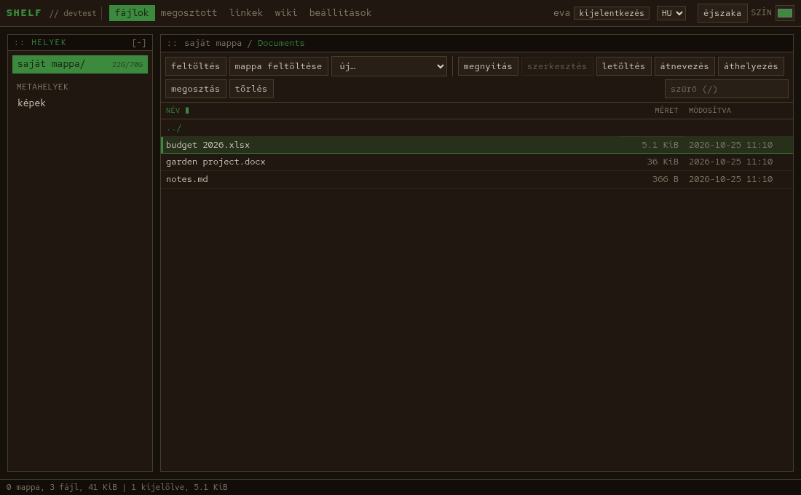
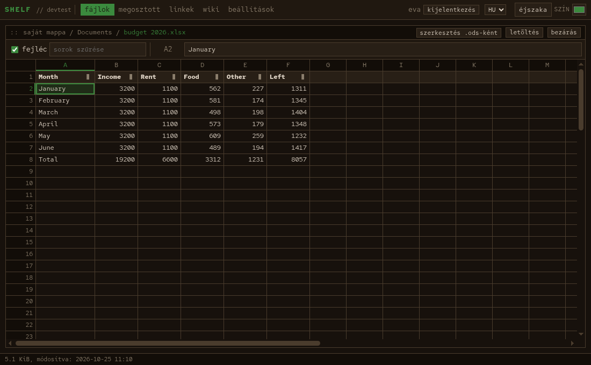
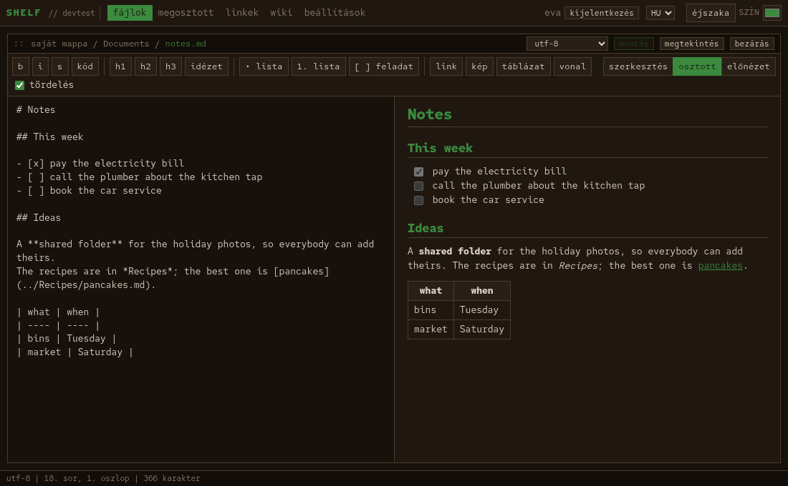
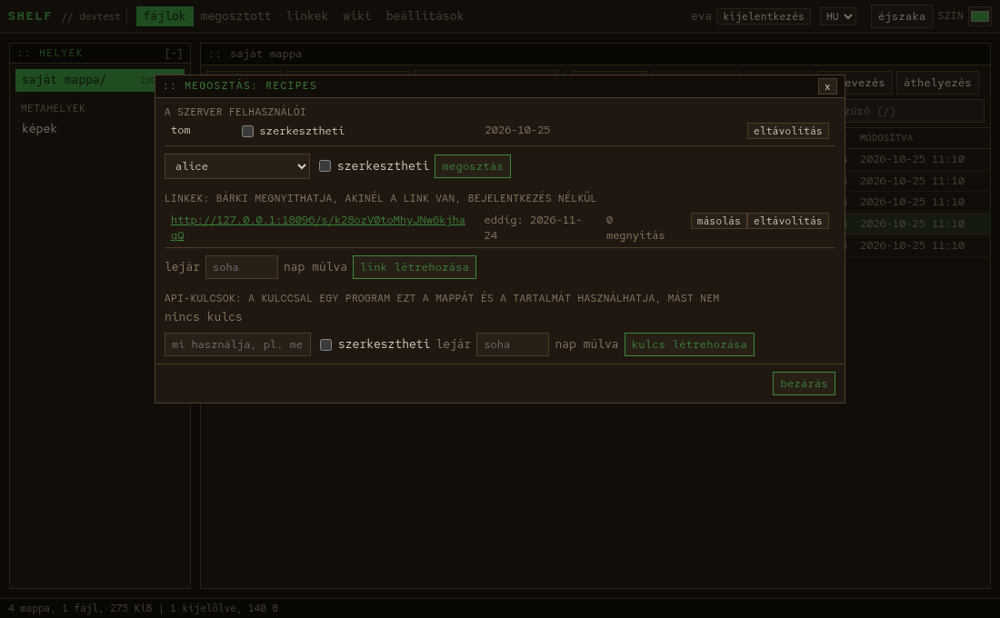
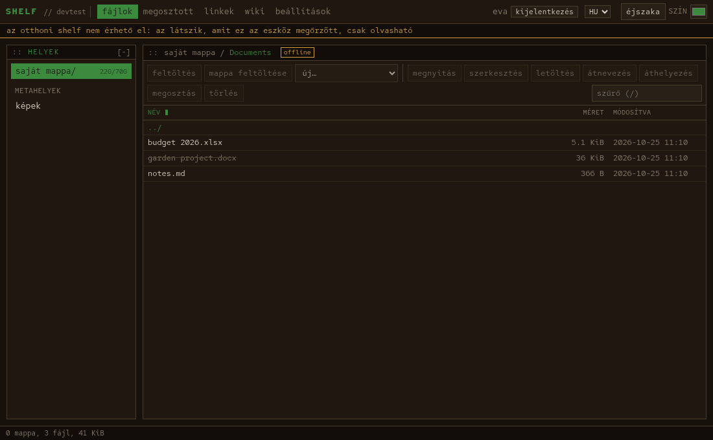
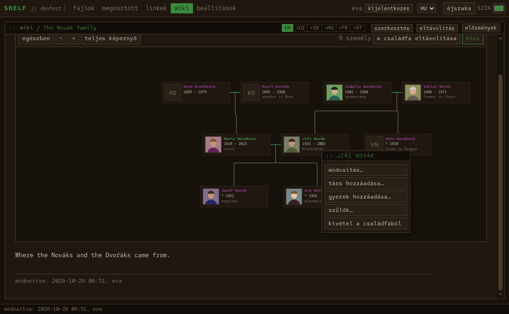

# osada: mi ez, és hogyan használjuk

A osada az otthoni fájltárolónk: egy kis szerver őrzi mindenki fájljait, és bármelyik böngészőből, valamint az Android-alkalmazásból elérhetők. A legtöbb fájlfajtát meg tudja mutatni és szerkeszteni, meg lehet osztani őket másokkal, és akkor is működik tovább, csak olvashatóan, amikor az otthoni szerver nem érhető el.

## Belépés

- Otthon: **http://192.168.1.10**
- Otthonon kívül: **https://shelf.example.org**, de csak azokról a hálózatokról, amelyeket az admin engedélyezett a fiókjának (admin → felhasználók → kívülről). Ha azt írja, hogy a fiók onnan nem használható, szóljon.
- A fiókokat az admin hozza létre. A jelszót a **beállítások** között változtathatja meg.
- A nyelvválasztó jobbra fent van (EN CZ SK HU FR AT). Bejelentkezve a választás a fiókjához kötődik, és más böngészőkben is érvényes.

## A kezdőlap és a fiókja

- Bejelentkezés után a **kezdőlap** nyílik meg: egy csempe mindenhez, amit használhat (fájlok, megosztott, hivatkozások, wiki, levelezés és más programok, például a apptab), a tárhelyével és a fiókjával.
- A bejelentkezés a nevét és a jelszavát kéri, majd egy második lépést, ha a fiókjának van ilyen: egy hitelesítő alkalmazás kódját (TOTP), vagy egy biztonsági kulcsot, illetve passkeyt. Egyes fiókoknak biztonsági kulcsot kell használniuk.
- **A fiókja** (a neve jobbra fent): a jelszó módosítása, a hitelesítő alkalmazás és a biztonsági kulcsok beállítása, és hogy hol van bejelentkezve; a többi munkamenetből kijelentkezhet.
- A **levelezés** saját lapon nyitja meg a webmailt, ha van postafiókja.
- Hogy egy fiók az otthonon kívül mely hálózatokról használhatja a osadaet, azt a rendszergazda állítja be fiókonként (admin → users, outside networks).

## A fájljai

A **fájlok** a **saját mappa** tartalmát mutatják: a mappákat és fájlokat, amelyeket csak ön lát. Balra vannak a **helyek**: a saját mappa, a **tárhelyek** (a beállításokban felvett SFTP-szerverek), a **velem megosztott** dolgok és a **képek** metahely.

- A **feltöltés** fájlokat, a **mappa feltöltése** egy egész mappát tölt fel abba a mappába, ahol éppen van; a fájlokat a listára is húzhatja.
- Az **új…** mappát, markdown-jegyzetet, szöveget, táblázatot, munkafüzetet, dokumentumot vagy bemutatót hoz létre.
- Jelöljön ki egy sort (kattintással; shift vagy ctrl és kattintás többhöz), aztán **megnyitás**, **szerkesztés**, **letöltés**, **átnevezés**, **áthelyezés**, **megosztás**, **verziók** vagy **törlés**.
- Billentyűzet: a nyilak mozognak, az Enter megnyit, a Backspace egy mappával feljebb visz, az F2 átnevez, a Del töröl, a / szűr, néhány begépelt betű pedig a névre ugrik.
- A mappák mérete egy pillanat múlva jelenik meg: minden számít, ami benne van. Tárhelykorlát esetén a helyek mutatják, mennyit használ belőle.

## Fájlok megtekintése

Nyisson meg egy fájlt, és látja: videók és zene (tekeréssel), képek (TIFF, Photoshop és fényképezőgépes raw is), PDF, szöveg, markdown, táblázatok (ods, xlsx, xls, csv), dokumentumok (odt, docx, doc, rtf), bemutatók (odp, pptx, ppt), levelek (eml, msg), archívumok (zip, 7z, rar, tar és mások; a bennük lévő fájlok is megnyílnak), e-könyvek, naptárak, névjegyek és betűtípusok. A bal és jobb nyíl az előző és a következő képre vagy videóra lép a mappában; az Esc bezár.

## Szerkesztés

A **szerkesztés** közvetlenül a böngészőben nyitja meg a markdown-, szöveg- és CSV-fájlokat, a munkafüzeteket (.ods), a dokumentumokat (.odt, .rtf) és a bemutatókat (.odp); a ctrl+s ment. A markdownnak előnézete van a szöveg mellett (szerkesztés, osztott, előnézet).

A Word-, Excel- és PowerPoint-fájlokat egy mellettük készülő másolatként lehet szerkeszteni: a **szerkesztés .ods-ként**, **szerkesztés .odt-ként** vagy **szerkesztés .odp-ként** készíti el, az eredeti pedig olyan marad, amilyen volt. Ha közben valaki más mentette a fájlt, a osada megkérdezi, mielőtt felülírná a változtatásait.

## Megosztás

A **megosztás** egy mappát vagy fájlt ad más felhasználóknak, csak olvashatóan, vagy úgy, hogy **szerkesztheti**; ezután megjelenik a **velem megosztott** helyükön. A **nyilvános link** bárkinek működik, akinél megvan, fiók nélkül is, és ha szeretné, csak egy adott dátumig. A **linkek** felsorolják a linkjeit, és hogy melyiket hányszor nyitották meg; egy link eltávolításával az azonnal megszűnik.

## Képek és korábbi verziók

A metahelyek között a **képek** egy rácsban mutat minden képet, ami az öné, és amit megosztottak önnel, a legújabbakat elöl, diavetítéssel. A **verziók** egy fájl vagy mappa korábbi verzióit mutatják az éjszakai mentésből, és visszaállítják a megváltozott vagy törölt fájlokat.

## A telefonon

Az Android-alkalmazás a osada egy alkalmazásban. Telepítse az Obtainiummal a **http://192.168.1.10:88/** címről (otthon); az Obtainium naprakészen tartja. Az otthoni Wi-Fin az alkalmazás az otthoni címet használja, máshol a nyilvánosat.

- A **beállítások → telefonok** párosítja a telefont, és a mappáit (kamera, képernyőképek és hasonlók) a saját mappájába másolja: óránként, és nem sokkal minden új kép után.
- Bármelyik alkalmazásban a **Megosztás → osada** feltölti a fájlokat a saját mappájába, és linket készít, amelyet másolhat vagy elküldhet e-mailben.

## Amikor az otthoni osada nem érhető el

Ha az otthoni szerver nem érhető el (áramszünet, internetkimaradás), a osada akkor is megnyílik abból, amit a böngészője vagy a telefonja megőrzött: a mappákból, amelyeket nézett, a fájlokból, amelyeket megnyitott, és ebből a wikiből. Ezt egy sáv jelzi felül, semmit nem lehet megváltoztatni, és ami az eszközön sosem volt megnyitva, az szürke. A nyilvános linkek tovább működnek azokra a fájlokra, amelyeket a nyilvános szerver már kiadott. Amikor az otthoni szerver újra válaszol, a sáv eltűnik, és minden a régiként működik.

(Böngészőben ez a https://shelf.example.org címen működik; az otthoni sima http-cím semmit sem tud megőrizni. A telefonos alkalmazás mindkét esetben megtartja a másolatait.)

## A wiki

Itt mindenki olvashat és írhat cikkeket.

- Az **új cikk** elkezd egyet, a **szerkesztés** megváltoztatja. Minden mentés megmarad az **előzmények** között, ahol egy korábbi szöveg megnézhető és visszaállítható.
- A **kitűzés** (a cikkben, vagy a listában, amikor az egér egy sor fölött van) a lista tetejére teszi a cikket, mindenkinek; a **levétel** visszateszi a többi közé.
- Egy cikknek minden nyelven lehet szövege. A fenti fülek mutatják, melyek vannak meg; a **+CZ**, **+SK** és a többi fordítást kezd abból a szövegből, amelyet éppen olvas. A cikk az ön nyelvén nyílik meg, ha megvan rajta, különben angolul.
- Képek: **képek hozzáadása** a szerkesztőben, vagy húzza, illessze be őket a szövegbe. A `` mutatja őket, és a cikkhez tartoznak, annak minden nyelvén.
- **Hivatkozások** más cikkekre: jelöljön ki néhány szót a szerkesztőben, és nyomja meg a **hivatkozás** gombot (vagy a ctrl+e-t). Megnyílik a cikkek listája; gépeljen a kereséshez (az ékezetek nem számítanak), és nyomjon Entert. Olyan név is jó, amelyről még senki nem írt: az ilyen hivatkozás más színű, mint a többi, és rákattintva megírható a cikk. A hivatkozások markdown-fájlokban is működnek.

### Családfák

A **családfa hozzáadása** családfát tesz egy cikkbe, annak minden nyelvére. Minden személy egy kártya: balra egy kép, a név, a dátumok és egy sor róla.

- **a családfa szerkesztése**, aztán kattintson egy kártyára: **módosítás…**, **szülő hozzáadása…**, **társ hozzáadása…**, **gyerek hozzáadása…**, **szülők…** vagy **kivétel a családfából**. Új rokon olyasvalaki is lehet, aki már a családfában van.
- Gyerekek különböző társaktól: a **gyerek hozzáadása…** megkérdezi a másik szülőt: az egyik társ, **valaki új…**, valaki más a családfából, vagy még senki. A **szülők…** beállítja vagy kijavítja, kik valakinek a szülei, és így egy gyereket másik párhoz tesz át.
- A testvérek egy sorban állnak, születésük szerint, ha az év ismert; a társ a személy mellé kerül, a második a másik oldalára; a nézet követi, amit hozzáad.
- Minden név az illető saját cikkére visz. A másik színű névnek még nincs cikke; rákattintva megírható, és azzal kezdődik, amit a családfa mond róla.
- Húzással mozoghat, görgővel vagy két ujjal nagyíthat; az **egészben** mindent mutat, a **teljes képernyő** az egész képernyőt neki adja.
- Minden változtatás azonnal mentődik, és megmarad az **előzmények** között, ahonnan egy korábbi családfa visszaállítható.
- A **JSON exportálása** egy fájlba menti a családfát a benne szereplők cikkeivel: a szövegeiket, ahogy meg vannak írva, a képek helyett pedig, hogy melyik hol van, és a szövegek szerint mit mutat.
