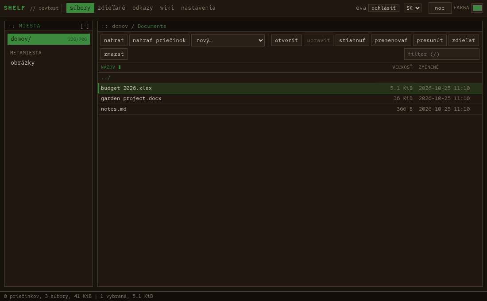
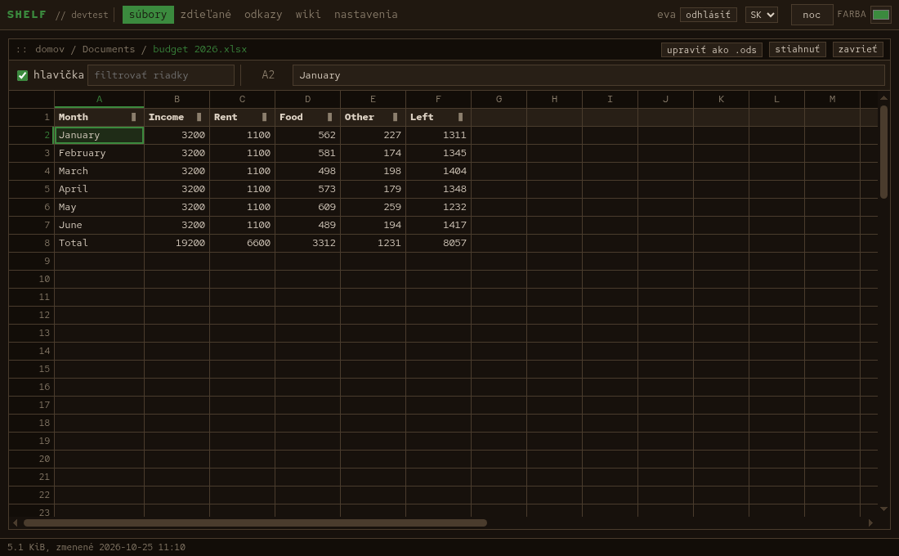
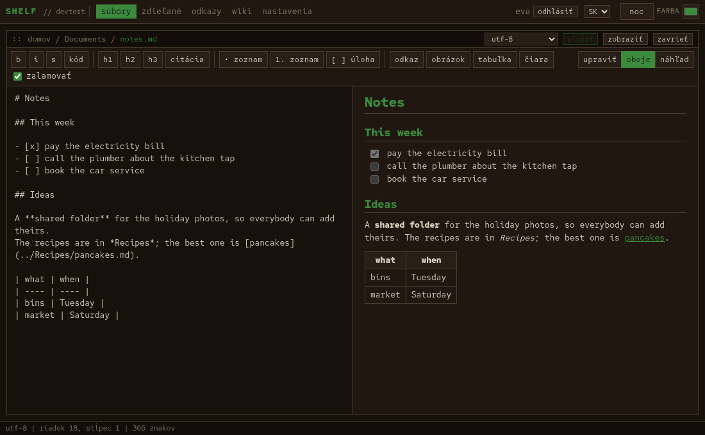
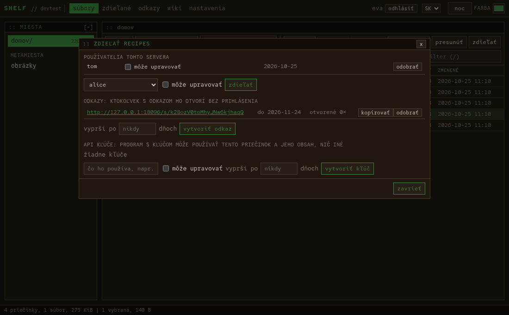
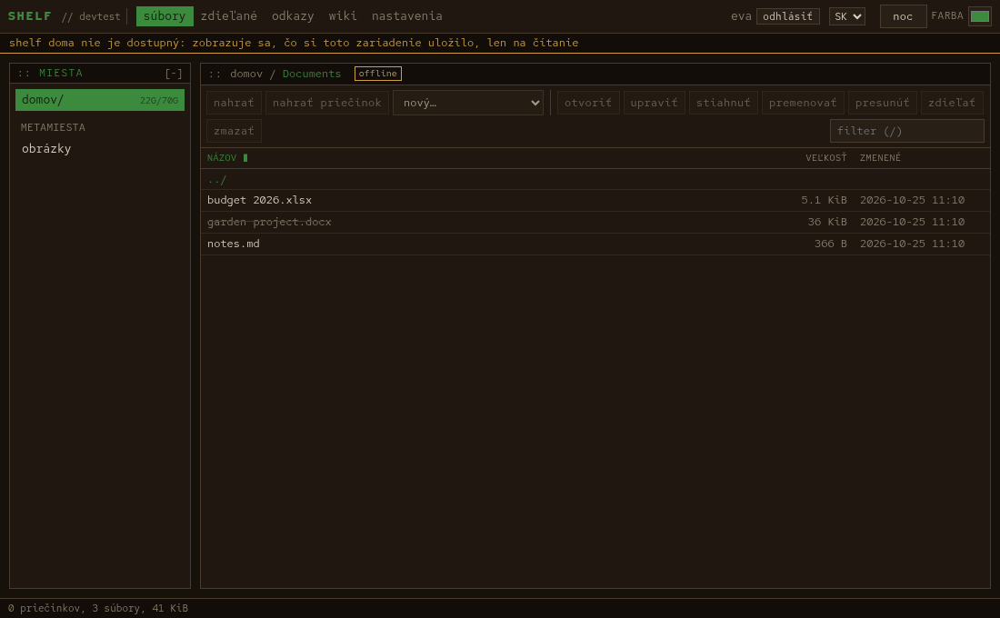
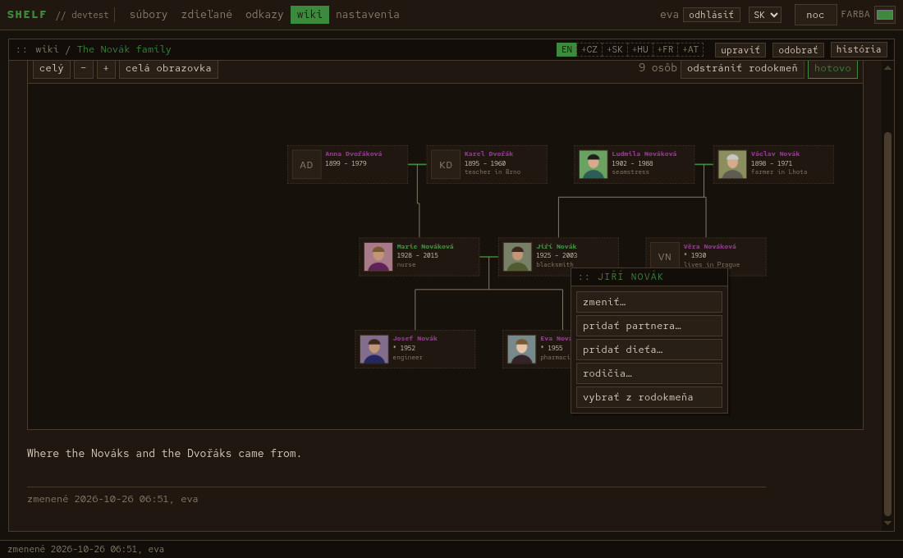

# osada: čo to je a ako ho používať

osada je naše úložisko súborov doma: jeden malý server uchováva súbory všetkých a dostanete sa k nim z ľubovoľného prehliadača aj z aplikácie pre Android. Väčšinu druhov súborov vie zobraziť a upraviť, zdieľať ich s ostatnými a funguje ďalej, len na čítanie, aj keď server doma nie je dostupný.

## Prihlásenie

- Doma: **http://192.168.1.10**
- Mimo domova: **https://shelf.example.org**, ale len zo sietí, ktoré admin vášmu účtu povolil (admin → používatelia → zvonku). Ak sa objaví, že účet odtiaľ nemožno použiť, povedzte.
- Účty zakladá admin. Heslo si zmeníte v **nastaveniach**.
- Voľba jazyka je vpravo hore (EN CZ SK HU FR AT). Po prihlásení sa zapamätá pre váš účet a platí aj v ďalších prehliadačoch.

## Úvodná stránka a váš účet

- Po prihlásení sa otvorí **úvodná stránka**: dlaždica pre všetko, čo môžete používať (súbory, zdieľané, odkazy, wiki, pošta a ďalšie programy ako apptab), s vaším úložiskom a účtom.
- Prihlásenie chce meno a heslo, potom druhý krok, ak ho váš účet má: kód z overovacej aplikácie (TOTP), alebo bezpečnostný kľúč či passkey. Niektoré účty musia používať bezpečnostný kľúč.
- **Váš účet** (vaše meno vpravo hore): zmena hesla, nastavenie overovacej aplikácie a bezpečnostných kľúčov a prehľad, kde ste prihlásení; ostatné relácie môžete odhlásiť.
- **pošta** otvorí webmail na vlastnej karte, ak máte poštovú schránku.
- Z ktorých sietí mimo domova smie účet osada používať, nastavuje správca pri každom účte (admin → users, outside networks).

## Vaše súbory

**súbory** ukazujú váš **domov**: priečinky a súbory, ktoré vidíte len vy. Vľavo sú **miesta**: domov, **úložiská** (SFTP servery pridané v nastaveniach), čo vám ostatní dali v **zdieľané so mnou** a metamiesto **obrázky**.

- **nahrať** vloží súbory, **nahrať priečinok** celý priečinok do priečinka, v ktorom ste; súbory môžete aj pretiahnuť na zoznam.
- **nový…** vytvorí priečinok, poznámku v markdowne, text, tabuľku, zošit, dokument alebo prezentáciu.
- Vyberte riadok (kliknutím; so shift alebo ctrl ich vyberiete viac) a potom **otvoriť**, **upraviť**, **stiahnuť**, **premenovať**, **presunúť**, **zdieľať**, **verzie** alebo **zmazať**.
- Klávesnica: šípky posúvajú, Enter otvára, Backspace ide o priečinok vyššie, F2 premenuje, Del zmaže, / filtruje a pár napísaných písmen skočí na meno.
- Veľkosti priečinkov sa objavia o chvíľu: počíta sa všetko vnútri. Ak máte limit úložiska, miesta ukazujú, koľko z neho používate.

## Prezeranie súborov

Otvorením súboru ho uvidíte: videá a hudbu (s pretáčaním), obrázky (aj TIFF, Photoshop a raw z fotoaparátov), PDF, text, markdown, tabuľky (ods, xlsx, xls, csv), dokumenty (odt, docx, doc, rtf), prezentácie (odp, pptx, ppt), poštu (eml, msg), archívy (zip, 7z, rar, tar a ďalšie; otvoria sa aj súbory vnútri), e-knihy, kalendáre, kontakty a písma. Šípky vľavo a vpravo prejdú na predchádzajúci a ďalší obrázok alebo video v priečinku; Esc zavrie.

## Úpravy

**upraviť** otvorí priamo v prehliadači súbory markdown, text a CSV, zošity (.ods), dokumenty (.odt, .rtf) a prezentácie (.odp); ctrl+s ukladá. Markdown má náhľad vedľa textu (upraviť, oboje, náhľad).

Súbory Wordu, Excelu a PowerPointu sa upravujú ako kópia vedľa nich: vytvorí ju **upraviť ako .ods**, **upraviť ako .odt** alebo **upraviť ako .odp** a originál zostane, aký bol. Ak súbor medzitým uložil niekto iný, osada sa spýta, skôr než jeho zmeny prepíše.

## Zdieľanie

**zdieľať** dá priečinok alebo súbor iným používateľom, len na čítanie, alebo tak, že **môže upravovať**; objaví sa im potom v **zdieľané so mnou**. **Verejný odkaz** funguje pre každého, kto ho má, aj bez účtu, a ak chcete, len do určitého dátumu. **odkazy** ukazujú vaše odkazy a koľkokrát bol ktorý otvorený; odstránením odkaz hneď prestane fungovať.

## Obrázky a staršie verzie

**obrázky** medzi metamiestami ukazujú v jednej mriežke všetky vaše obrázky aj tie zdieľané s vami, najnovšie prvé, s prezentáciou. **verzie** ukazujú staršie verzie súboru alebo priečinka z nočnej zálohy a vrátia zmenené alebo zmazané súbory.

## V telefóne

Aplikácia pre Android je osada v aplikácii. Nainštalujte ju cez Obtainium z **http://192.168.1.10:88/** (doma); Obtainium ju udržiava aktuálnu. Na domácej Wi-Fi aplikácia používa domácu adresu, inde verejnú.

- **nastavenia → telefóny** spáruje telefón a kopíruje jeho priečinky (fotoaparát, snímky obrazovky a podobne) do vášho domova: každú hodinu a čoskoro po každej novej fotke.
- **Zdieľať → osada** v akejkoľvek aplikácii uloží súbory do domova a vytvorí odkaz, ktorý môžete skopírovať alebo poslať e-mailom.

## Keď osada doma nie je dostupný

Keď server doma nie je dostupný (výpadok prúdu, internetu), osada sa aj tak otvorí z toho, čo si váš prehliadač alebo telefón uložil: priečinky, ktoré ste prezerali, súbory, ktoré ste otvorili, a táto wiki. Hovorí to pruh hore, nič nemožno zmeniť a čo zariadenie nikdy neotvorilo, je zašednuté. Verejné odkazy ďalej fungujú pre súbory, ktoré už verejný server vydal. Len čo domov znova odpovie, pruh zmizne a všetko funguje ako predtým.

(V prehliadači to funguje cez https://shelf.example.org; obyčajná http adresa doma si nič uložiť nemôže. Aplikácia v telefóne si kópie drží v oboch prípadoch.)

## Wiki

Články tu môže čítať a písať každý.

- **nový článok** založí článok, **upraviť** ho zmení. Každé uloženie zostáva v **histórii**, kde sa dá starší text pozrieť a vrátiť.
- **pripnúť** (v článku, alebo v zozname, keď je myš nad riadkom) dá článok navrch zoznamu, pre všetkých; **odopnúť** ho vráti medzi ostatné.
- Článok môže mať text v každom jazyku. Záložky hore ukazujú, ktoré existujú; **+CZ**, **+HU** a ďalšie začnú preklad z textu, ktorý práve čítate. Článok sa otvorí vo vašom jazyku, ak ho má, inak v angličtine.
- Obrázky: **pridať obrázky** v editore, alebo ich pretiahnite či vložte do textu. Zobrazí ich `` a patria k článku, vo všetkých jeho jazykoch.
- **Odkazy** na iné články: v editore označte pár slov a stlačte **odkaz** (alebo ctrl+e). Otvorí sa zoznam článkov; píšte, čo hľadáte (na diakritike nezáleží), a stlačte Enter. Funguje aj meno, o ktorom zatiaľ nikto nepísal: taký odkaz má inú farbu než ostatné a kliknutím naň môžete ten článok napísať. Odkazy fungujú aj v súboroch markdown.

### Rodokmene

**pridať rodokmeň** vloží do článku rodokmeň, pre všetky jeho jazyky. Každá osoba je karta: vľavo obrázok, meno, dátumy a riadok o nej.

- **upraviť rodokmeň** a potom kliknite na kartu: **zmeniť…**, **pridať rodiča…**, **pridať partnera…**, **pridať dieťa…**, **rodičia…** alebo **vybrať z rodokmeňa**. Novým príbuzným môže byť aj niekto, kto už v rodokmeni je.
- Deti s rôznymi partnermi: **pridať dieťa…** sa pýta na druhého rodiča: jedného z partnerov, **niekto nový…**, niekoho ďalšieho z rodokmeňa, alebo zatiaľ nikoho. **rodičia…** nastaví alebo opraví, kto sú niečí rodičia, a tak presunie dieťa k inému páru.
- Súrodenci stoja v jednom rade, podľa narodenia, ak je rok známy; partner stojí vedľa osoby, druhý na druhej strane; zobrazenie sleduje, čo pridávate.
- Každé meno vedie na vlastný článok tej osoby. Meno v tej druhej farbe článok zatiaľ nemá; kliknutím ho môžete napísať a začne tým, čo o osobe hovorí rodokmeň.
- Ťahaním sa posúvate, kolieskom alebo dvoma prstami približujete; **celý** ukáže všetko, **celá obrazovka** mu dá celú obrazovku.
- Každá zmena sa hneď uloží a zostáva v **histórii**, odkiaľ možno starší rodokmeň vrátiť.
- **export JSON** uloží rodokmeň s článkami jeho ľudí do jedného súboru: ich texty, ako sú napísané, a namiesto obrázkov, kde ktorý je a čo podľa textov ukazuje.
